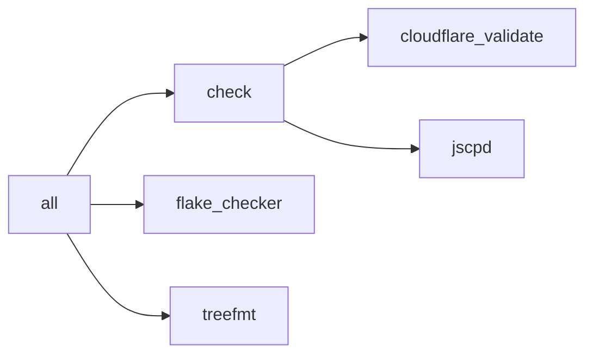

# `nk` in `tests/fixtures/cloudflare`

```text
Available recipes:
    [cloudflare]
    cloudflare-validate *args # Validate the Cloudflare Terraform configuration
    deploy *args              # Publish the site to Cloudflare
    terraform *args           # Plan Cloudflare changes, or run terraform <command> [args]

    [gitleaks]
    secret-history *args      # Scan Git history for secrets

    [jscpd]
    jscpd *args               # Find duplicated code

    [nix]
    flake-checker *args       # Check flake.lock for outdated or non-upstream Nixpkgs
    flake-update *args        # `nix flake update` flake.lock and dev/flake.lock, then write-files and generate-files; args go to `nix flake update` and skip dev/flake.lock

    [nullkomma]
    all *args                 # Format and run all checks
    check *args               # Run all checks
    generate-files *args      # Overwrite Git-ignored files generated from Nix
    graph *args               # Print the process dependency graph; args go to `process-compose graph` (default: -f mermaid)
    mcp                       # Serve the tasks as MCP tools over stdio, for agents
    treefmt *args             # Format and lint all files
    write-files *args         # Write source-of-truth files; keep your edits and report upstream conflicts
```

## `nk graph`


