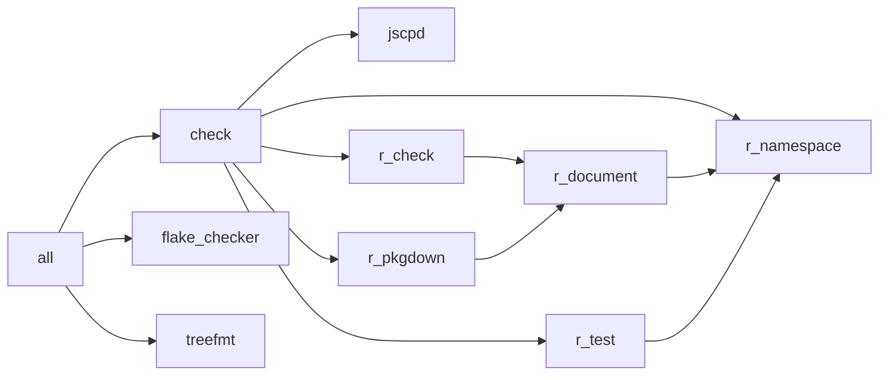

# `nk` in `tests/fixtures/r-remotes`

```text
Available recipes:
    [gitleaks]
    secret-history *args # Scan Git history for secrets

    [jscpd]
    jscpd *args          # Find duplicated code

    [nix]
    flake-checker *args  # Check flake.lock for outdated or non-upstream Nixpkgs
    flake-update *args   # `nix flake update` flake.lock and dev/flake.lock, then write-files and generate-files; args go to `nix flake update` and skip dev/flake.lock

    [nullkomma]
    all *args            # Format and run all checks
    check *args          # Run all checks
    generate-files *args # Overwrite Git-ignored files generated from Nix
    graph *args          # Print the process dependency graph; args go to `process-compose graph` (default: -f mermaid)
    mcp                  # Serve the tasks as MCP tools over stdio, for agents
    treefmt *args        # Format and lint all files
    write-files *args    # Write source-of-truth files; keep your edits and report upstream conflicts

    [r]
    r-check *args        # Run R CMD check
    r-document *args     # Generate R manuals and NAMESPACE with roxygen2
    r-lock *args         # Resolve DESCRIPTION into the R lockfile (pkg.lock) with pak
    r-namespace *args    # Generate NAMESPACE with roxygen2; --check fails if it was stale
    r-pkgdown *args      # Build the pkgdown website; --preview opens it in a browser
    r-test *args         # Run testthat on the working-tree package, loaded with pkgload; --installed tests the installed package
```

## `nk graph`


